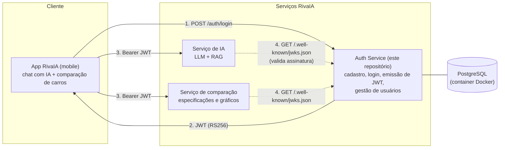
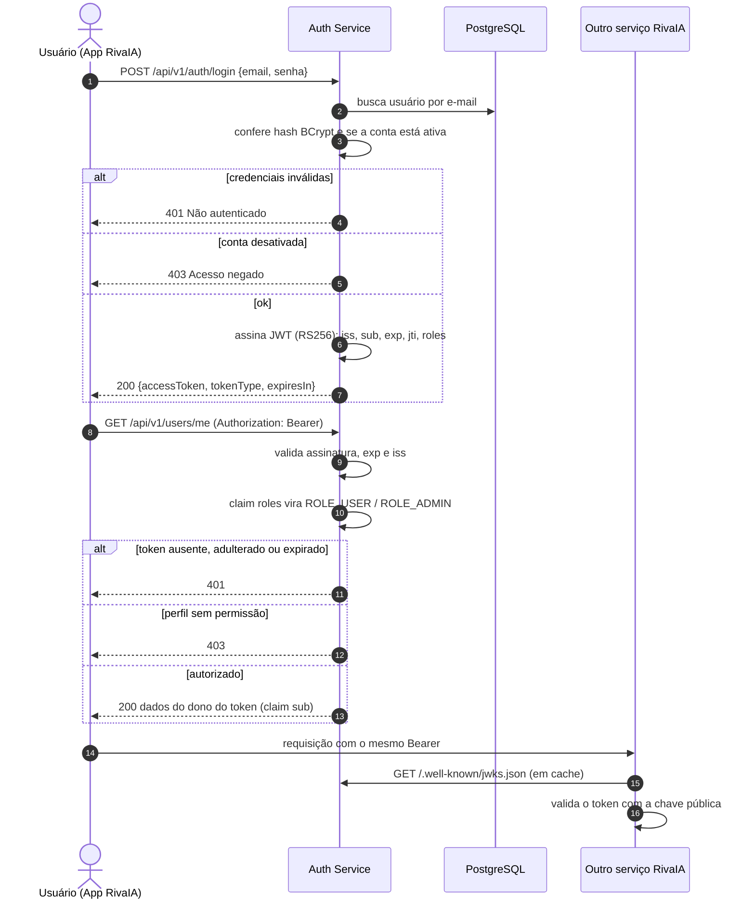

# RivaIA Auth Service

## Integrantes 

- Beatriz Novais - RM554746
- Mariana Neugbauer - RM550494
- Gustavo Paulino - RM554779
- Guilherme Abe - RM554743
- Victor Pacifico - RM558017

Microsserviço de identidade da **RivaIA**, solução do Desafio 01 (Inteligência Competitiva Automotiva) do Challenge Ford × FIAP 2026. Ele concentra cadastro de usuários, login e emissão de tokens **JWT**, que os demais serviços da RivaIA consomem para autenticar e autorizar as requisições.

Entrega da Sprint 3 de **Arquitetura Orientada a Serviços e Web Services**.

**Stack:** Java 25 · Spring Boot 4.0 · Spring Security 7 (OAuth2 Resource Server) · Spring Data JPA · Flyway · PostgreSQL 17 (Docker) · springdoc-openapi (Swagger) · JUnit 5 + MockMvc

---

## 1. Arquitetura da solução

O Auth Service é o único ponto que conhece senhas e emite tokens. Ele assina os JWT com uma **chave privada RSA (RS256)** e publica a **chave pública** em `/.well-known/jwks.json`. Assim, qualquer outro serviço da RivaIA valida o token sozinho, sem chamar o Auth Service a cada requisição e sem compartilhar segredo.



> Os serviços de IA e de comparação já existem na RivaIA e estão fora do escopo deste repositório. O diagrama mostra como eles se integram ao Auth Service.

### Componentes e responsabilidades

| Camada | Pacote | Responsabilidade |
|---|---|---|
| Controllers (REST) | `auth`, `user`, `security.JwksController` | Expor recursos HTTP, validar entrada (`@Valid`), definir status codes |
| Serviços | `AuthService`, `UserService`, `TokenService` | Regras de negócio: credenciais, unicidade de e-mail, regras de admin, geração do token |
| Persistência | `UserRepository`, `User`, `db/migration` | Acesso ao PostgreSQL via JPA; schema versionado pelo Flyway |
| Segurança | `security` | Cadeia de filtros, validação do JWT, mapeamento de perfis, respostas 401/403 |
| Erros | `common.error` | Formato único de erro para toda a API |
| Configuração | `config` | Propriedades do JWT, admin inicial, OpenAPI |

### Fluxo de autenticação e autorização



---

## 2. Autenticação e autorização

### Perfis

| Perfil | Como é criado | O que pode fazer |
|---|---|---|
| `USER` | Cadastro público (`/auth/register`) ou pelo ADMIN | Consultar e editar o próprio perfil, trocar a própria senha |
| `ADMIN` | Admin inicial (variáveis `ADMIN_*`) ou promoção por outro ADMIN | Tudo do USER + cadastrar, listar, atualizar (perfil/status) e remover usuários |

A regra é aplicada em duas camadas: no `SecurityFilterChain` (por rota) e com `@PreAuthorize("hasRole('ADMIN')")` no controller administrativo.

### Endpoints

| Método | Recurso | Acesso | Sucesso | Erros |
|---|---|---|---|---|
| POST | `/api/v1/auth/register` | Público | 201 + `Location` | 400, 409 |
| POST | `/api/v1/auth/login` | Público | 200 | 400, 401, 403 |
| GET | `/.well-known/jwks.json` | Público | 200 | |
| GET | `/api/v1/users/me` | USER, ADMIN | 200 | 401, 403 |
| PUT | `/api/v1/users/me` | USER, ADMIN | 200 | 400, 401, 409 |
| PUT | `/api/v1/users/me/password` | USER, ADMIN | 204 | 400, 401 |
| GET | `/api/v1/users?page=&size=` | ADMIN | 200 | 400, 401, 403 |
| GET | `/api/v1/users/{id}` | ADMIN | 200 | 400, 401, 403, 404 |
| POST | `/api/v1/users` | ADMIN | 201 + `Location` | 400, 401, 403, 409 |
| PUT | `/api/v1/users/{id}` | ADMIN | 200 | 400, 401, 403, 404, 409 |
| DELETE | `/api/v1/users/{id}` | ADMIN | 204 | 401, 403, 404, 409 |

### JWT

- **Assinatura:** RS256. A chave privada nunca sai do serviço; a pública fica em `/.well-known/jwks.json`.
- **Validação em cada requisição:** assinatura, expiração (`exp`, com tolerância padrão de 60 s) e emissor (`iss`).
- **Expiração:** configurável por `JWT_EXPIRATION` (padrão `1h`). A resposta do login informa `expiresIn` e `expiresAt`.
- **Claims:** `iss`, `sub` (id do usuário), `iat`, `exp`, `jti`, `roles`, `email`, `name`. Não há dado sensível no token.
- **Uso do token:** os endpoints `/users/me` identificam o usuário pelo `sub`, nunca por id na URL, então um usuário não consegue ler nem alterar dados de outro. Se a conta for desativada, o acesso é negado mesmo com o token ainda válido.
- **Chave gerada na inicialização:** ao reiniciar o serviço, os tokens antigos deixam de valer. Em produção, a chave seria carregada de um cofre de segredos.

---

## 3. Maturidade REST (nível 2)

- **Recursos:** `users`, `users/{id}`, `users/me`, `users/me/password`.
- **Verbos com semântica HTTP:** `GET` consulta, `POST` cria, `PUT` substitui, `DELETE` remove.
- **Status codes coerentes:** `201 Created` com header `Location` na criação, `204 No Content` em remoção e troca de senha, `400` validação, `401` sem autenticação, `403` sem permissão, `404` inexistente, `405` método não suportado, `409` conflito, `500` erro inesperado.

---

## 4. Padrão de erros

Todas as respostas de erro usam `Content-Type: application/problem+json`, no formato da RFC 9457:

```json
{
  "type": "about:blank",
  "title": "Dados inválidos",
  "status": 400,
  "detail": "Um ou mais campos não passaram na validação.",
  "instance": "/api/v1/auth/register",
  "timestamp": "2026-09-27T21:00:00Z",
  "errors": [
    { "field": "email", "message": "deve ser um endereço de e-mail bem formado" }
  ]
}
```

O mesmo formato vale para os 401/403 gerados pelo Spring Security (`ProblemAuthenticationEntryPoint` e `ProblemAccessDeniedHandler`).

---

## 5. Como executar

### Pré-requisitos

- Docker e Docker Compose (para o banco)
- IntelliJ IDEA com JDK 25 (para a API)

### 1. Subir o banco (PostgreSQL no Docker)

```bash
docker compose up -d
```

O container `rivaia-auth-db` expõe o PostgreSQL em `localhost:5432`, com o banco `rivaia_auth`. As tabelas são criadas pelo Flyway quando a API sobe.

### 2. Subir a API

No IntelliJ, abra a pasta do projeto (ele importa o `pom.xml` automaticamente) e execute a classe `RivaiaAuthApplication`.

- API: http://localhost:8080
- Swagger UI: http://localhost:8080/swagger-ui.html
- OpenAPI (JSON): http://localhost:8080/v3/api-docs
- Admin inicial: `admin@rivaia.com` / `Admin@12345`

No Swagger, faça o login em `POST /api/v1/auth/login`, copie o `accessToken`, clique em **Authorize** e cole o token.

O arquivo `docs/requests.http` tem o roteiro de chamadas pronto para o VS Code (extensão REST Client) ou IntelliJ.

Para parar o banco: `docker compose down` (adicione `-v` para apagar os dados).

### Variáveis de ambiente

Todas têm valor padrão, então não é preciso configurar nada para rodar localmente. Para trocar, defina a variável em **Run > Edit Configurations > Environment variables** no IntelliJ. As credenciais do banco também podem ser alteradas copiando `.env.example` para `.env` (lido pelo Docker Compose).

| Variável | Padrão | Descrição |
|---|---|---|
| `DB_URL` | `jdbc:postgresql://localhost:5432/rivaia_auth` | URL JDBC do PostgreSQL |
| `DB_USER` / `DB_PASSWORD` | `rivaia` / `rivaia` | Credenciais do banco |
| `JWT_ISSUER` | `rivaia-auth-service` | Claim `iss` |
| `JWT_EXPIRATION` | `1h` | Validade do token (`15m`, `2h`...) |
| `ADMIN_NAME` / `ADMIN_EMAIL` / `ADMIN_PASSWORD` | `Administrador RivaIA` / `admin@rivaia.com` / `Admin@12345` | Admin criado na primeira subida |

---

## 6. Testes automatizados

Os testes sobem a aplicação completa (segurança, JWT, JPA) com banco H2 em memória e fazem requisições HTTP reais via MockMvc. Não precisam do banco no Docker.

**Como rodar no IntelliJ:** na aba Project, clique com o botão direito na pasta `src/test/java` e escolha **Run 'All Tests'**. Para rodar só uma classe, abra o arquivo e clique no ícone ▶ ao lado do nome da classe.

| Classe | Cobre |
|---|---|
| `AuthApiTest` | cadastro (201, 400, 409, JSON malformado), login (200, 401 senha errada, 401 e-mail inexistente, 403 conta desativada) |
| `TokenSecurityTest` | sem token (401), token válido, claims do JWT, assinatura adulterada, token malformado, token expirado, emissor errado, JWKS e Swagger públicos, 404 padronizado |
| `ProfileApiTest` | atualização do próprio perfil, conflito de e-mail, troca de senha (204 e senha antiga deixa de valer), senha atual errada |
| `AdminUsersApiTest` | USER recebendo 403, sem token 401, CRUD completo do ADMIN (201/200/200/204/404), promoção a ADMIN, 409 em duplicidade e autoexclusão, 400 em paginação e id inválidos, 405 |

**Evidência da execução:** o resultado aparece na janela **Run** do IntelliJ, com cada teste marcado como aprovado ou reprovado. Para gerar um relatório, use o botão **Export Test Results** dessa janela (formato HTML).

---

## 7. Estrutura do projeto

```
src/main/java/br/com/rivaia/auth
├── RivaiaAuthApplication.java
├── auth/            # login, cadastro público, emissão de token
├── user/            # entidade, repositório, perfil (/me) e gestão (ADMIN)
├── security/        # SecurityFilterChain, chaves RSA, JWKS, handlers 401/403
├── common/error/    # exceções de domínio e handler global de erros
└── config/          # propriedades, admin inicial, OpenAPI
src/main/resources
├── application.yml
└── db/migration/    # scripts Flyway
src/test/java/...    # testes de integração da API
```